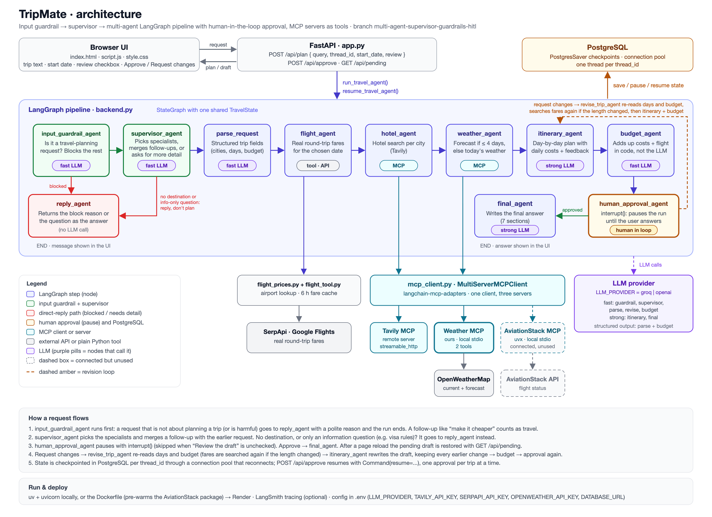
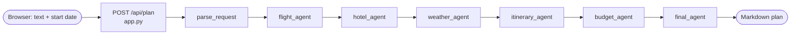

# ✈️ TripMate – AI Travel Planner

TripMate turns a plain-English trip request ("5 day trip from Hyderabad to Seoul, budget ₹1,50,000") into a full travel plan: real flight fares, hotels, weather, a day-by-day itinerary and a computed budget.

It is a **multi-step LangGraph workflow** served by **FastAPI**, with a small chat-style web UI. Hotels and weather are fetched through **MCP (Model Context Protocol) servers**, one of which is written in this repo.

**🌐 Live demo: <https://tripmate-langgraph.onrender.com>** (free tier: the first load after idle can take ~1 minute)



> The diagram is `docs/architecture.svg` (editable) rendered to `docs/architecture.png`.

---

## If you are coming back after a long time, read this first

**The 60-second version**

1. The browser sends the request text (+ an optional start date) to `POST /api/plan` in `app.py`.
2. `app.py` calls `run_travel_agent()` in `backend.py`, which runs a **LangGraph pipeline of 7 steps, one after another**, all sharing one `TravelState` dict.
3. Each step either calls an LLM, calls a plain Python tool, or calls an MCP tool through `mcp_client.py`.
4. The last step writes the answer in Markdown. State is checkpointed to PostgreSQL per `thread_id`.

**Where to start reading the code:** `backend.py`, from the bottom up. `run_travel_agent()` → the graph definition (`graph.add_node(...)`) → each node function in the same order.

**Three things that surprise people (including future me)**

- It is a **fixed pipeline, not a free-roaming agent.** The code decides which tool runs; the LLM never picks a tool. (Making one step a real tool-choosing ReAct agent is the top item in [Next steps](#next-steps).)
- **Only two of the three MCP servers are used.** AviationStack MCP is connected in `mcp_client.py` but no graph step calls it. Flight fares come from a *direct* SerpApi call, not from MCP.
- **The weather API only sees 5 days ahead.** So weather is a real forecast only when the trip starts within ~4 days; otherwise it is a "today's weather" climate hint.

---

## Request lifecycle



| Step (node in `backend.py`) | What it does | Uses |
|---|---|---|
| `parse_request` | Turns free text into structured fields: destination, origin, `cities` (for multi-city trips), `trip_days`, `budget_inr`, `budget_level`, `arrival_airport`. | fast LLM (structured output) |
| `flight_agent` | Looks up real **round-trip fares** for the chosen date and formats the best few options. If nothing is found, it writes a note telling the planner to use clearly labelled estimates. | `tools/flight_prices.py` → SerpApi Google Flights |
| `hotel_agent` | One web search per city for hotels with prices. | Tavily **MCP** (remote) |
| `weather_agent` | Trip starts within 4 days → day-by-day forecast. Otherwise → today's weather as a climate hint. One call per city, in parallel; a failed city does not break the plan. | Weather **MCP** (ours) → OpenWeatherMap |
| `itinerary_agent` | Writes the day-by-day plan and ends every day with a `Costs:` line. Real flight fares are deliberately **left out** of those lines. | strong LLM |
| `budget_agent` | Reads the `Costs:` lines, **adds the flight fare** (fare × travellers), and sums everything **in Python** (LLMs add badly). | fast LLM (extraction) + code |
| `final_agent` | Writes the final answer in 7 sections (summary, flights, hotels, weather, itinerary, budget, recommendations) using the computed budget table. | strong LLM |

**Fast vs strong LLM:** `build_llm("fast")` is a cheap model for parsing and extraction; `build_llm("strong")` is the best model for the itinerary and final answer. Both come from `LLM_PROVIDER` (`groq` default, or `openai`).

---

## What every file does

```
.
├── app.py                         FastAPI app: serves the UI, exposes POST /api/plan
├── backend.py                     THE CORE: TravelState, LLM setup, all 7 node functions,
│                                  graph wiring, Postgres checkpointer, run_travel_agent()
├── mcp_client.py                  One MultiServerMCPClient for 3 MCP servers + helper
│                                  functions (tavily_mcp_search, weather_now, weather_forecast)
├── custom_weather_mcp_server.py   OUR OWN MCP server (FastMCP, stdio): get_current_weather,
│                                  get_forecast. Launched by mcp_client.py as a subprocess.
├── tools/
│   ├── flight_prices.py           Real fares via SerpApi (Google Flights): date handling,
│   │                              6-hour in-memory cache, formatting
│   ├── flight_tool.py             Airport/IATA resolution (cities, countries, states) built on
│   │                              `airportsdata`, plus LOCATION_OVERRIDES for places it gets
│   │                              wrong. Also an older AviationStack lookup (search_flights)
│   │                              that the graph no longer uses.
│   └── tavily_tool.py             Older direct Tavily client. Replaced by the Tavily MCP server;
│                                  kept for reference.
├── templates/index.html           The single page (chat box + start-date picker)
├── static/script.js, style.css    Frontend logic and styling (sends query/thread_id/start_date)
├── docs/                          architecture.svg / architecture.png
├── test.py                        Prints every tool the MCP client can see (a quick MCP check)
├── mcp_client_test.py             Old scratch file from when MCP was first tried; safe to ignore
├── main.py                        Empty `uv init` stub; safe to ignore
├── Dockerfile                     Container image (also pre-downloads the AviationStack MCP)
└── pyproject.toml / uv.lock       Dependencies (source of truth)
```

---

## The MCP part, explained

`mcp_client.py` builds **one** `MultiServerMCPClient` that talks to **three** MCP servers. Each server exposes tools (plain functions the client can call by name).

| Server | Transport | Where it runs | Who wrote it | Used by the graph? |
|---|---|---|---|---|
| **Tavily** | `streamable_http` | Remote, on Tavily's servers | Tavily | Yes: `hotel_agent` (`tavily_search`) |
| **Weather** | `stdio` | Local subprocess (`sys.executable custom_weather_mcp_server.py`) | **Us** | Yes: `weather_agent` |
| **AviationStack** | `stdio` via `uvx` | Local subprocess (package downloaded from PyPI and cached) | Third party | **No** (connected, never called) |

**Why write our own weather server?** So we control the output: it returns 6 fields instead of the whole API response, and `get_forecast` returns a short per-day summary (min/max °C and the most common condition) instead of 40 three-hour entries.

**How a tool call travels:** `weather_agent` → `weather_now(city)` in `mcp_client.py` → `weather_mcp_call` → MCP client starts/uses the weather subprocess → `get_current_weather` in `custom_weather_mcp_server.py` → OpenWeatherMap → result flows back as JSON text.

**To see what the client can discover:** `uv run python test.py` prints all tool names (Tavily 5, AviationStack 12, weather 2).

**Handy facts**
- Passing `env={...}` to a stdio server is how its API key reaches the subprocess. A subprocess does **not** inherit your whole environment, and in Docker there is no `.env` file.
- `async def` / `await` is needed for MCP calls. The sync LangGraph nodes use `asyncio.run(...)` to call them.

---

## Start date and weather logic

- The UI has a **Trip start date** picker, pre-filled with today + 60 days and blocking past dates. Its value travels as `start_date` through `app.py` → `run_travel_agent()` → `TravelState`.
- `flight_prices.py` searches fares for exactly that date; with no date it falls back to today + 60 days (`DAYS_AHEAD`).
- `weather_agent` uses the forecast only if the start is **0–4 days away** (the free OpenWeather forecast covers 5 days); otherwise it labels the result "Weather today (climate hint only…)" so the planner does not present it as the trip-date forecast.

---

## Airports: the one place that bit us

The planner resolves city names to airport codes with `airportsdata`, and some names collide: **"Goa" matched `GOA` (Genoa, Italy)** instead of `GOI`, and "Bali" matched an airport in Cameroon. The fix is the `LOCATION_OVERRIDES` table in `tools/flight_tool.py`, checked first. It also beats the LLM's guessed `arrival_airport`. **If a route returns odd fares, check the airport code first** and add an override.

---

## Configuration

Create a `.env` in the project root (never commit it; it is in `.gitignore`).

| Variable | Needed? | Used for |
|---|---|---|
| `GROQ_API_KEY` | If `LLM_PROVIDER=groq` (default) | LLM |
| `GROQ_MODEL` | Optional | Default `openai/gpt-oss-120b` |
| `LLM_PROVIDER` | Optional | `groq` (default) or `openai` |
| `OPENAI_API_KEY`, `OPENAI_FAST_MODEL`, `OPENAI_STRONG_MODEL` | If `LLM_PROVIDER=openai` | LLM (two model tiers) |
| `TAVILY_API_KEY` | Yes | Hotel search (Tavily MCP) |
| `SERPAPI_API_KEY` | Yes for real fares | Google Flights fares (free plan: 250 searches/month) |
| `OPENWEATHER_API_KEY` | Yes for weather | Weather MCP server |
| `AVIATIONSTACK_API_KEY` | Optional | Only the (unused) AviationStack MCP and old `search_flights` |
| `DATABASE_URL` | Yes | PostgreSQL (`sslmode=require` is added if missing) |
| `DEFAULT_ORIGIN_IATA` | Optional | Origin airport when the request names none (default `HYD`) |
| `LANGSMITH_TRACING`, `LANGSMITH_API_KEY`, `LANGSMITH_PROJECT` | Optional | Tracing |

Note: `flight_tool.py` also accepts the misspelt `DEAFAULT_ORIGIN_IATA` as a fallback (kept for an old `.env`).

---

## Run it

**Prerequisites:** Python 3.12+, [uv](https://docs.astral.sh/uv/), a PostgreSQL database, and the API keys above.

```bash
git clone https://github.com/bsivavenu/tripmate_langgraph.git
cd tripmate_langgraph
uv sync
uv run uvicorn app:app --reload        # then open http://127.0.0.1:8000
```

Quick checks without the UI:

```bash
uv run python test.py                  # lists every MCP tool (Tavily, AviationStack, weather)
uv run python -m tools.flight_prices   # prints a sample fare lookup (uses 1 SerpApi search)
```

### Docker

```bash
docker build -t tripmate .
docker run -d --name tripmate --env-file .env -p 8000:8000 tripmate
```

The container listens on `$PORT` (default `8000`). The Dockerfile pre-downloads `aviationstack-mcp` with `uvx` (it needs Python ≥ 3.13, so uv fetches a managed 3.13 for that tool only).

### Deploy (Render)

Deployed as a Docker web service from this repo's `Dockerfile`. Set the same variables as in `.env` in the service's *Environment* tab (use Render's **internal** database URL when in the same region). The live demo's Render service tracks its own branch, which is separate from this one, so pushing `multi-agent-with-mcp` does not change the live site.

---

## API

`POST /api/plan`

```json
{ "query": "4 day trip from Mumbai to Dubai, budget ₹80,000",
  "thread_id": null,
  "start_date": "2026-12-05" }
```

Response:

```json
{ "thread_id": "user_ab12…",
  "answer": "## 1. Trip summary …",
  "flight_results": "…", "hotel_results": "…",
  "weather_results": "…", "itinerary": "…", "llm_calls": 3 }
```

`start_date` is optional (`YYYY-MM-DD`). `thread_id` keys the saved state in PostgreSQL; the browser keeps it in `localStorage`. Errors return `{"detail": "..."}` with status 500.

---

## Tech stack

LangGraph + LangChain · Groq or OpenAI · MCP (`langchain-mcp-adapters`, `mcp` / FastMCP) · Tavily · SerpApi · OpenWeatherMap · `airportsdata` · PostgreSQL (`langgraph-checkpoint-postgres`) · FastAPI + Uvicorn · plain HTML/CSS/JS (`marked`, `DOMPurify`) · `uv` · Docker · LangSmith (optional).

---

## Branches

| Branch | What it is |
|---|---|
| `main` | Baseline |
| `multi-agent-without-mcp` | The pipeline using direct tool clients |
| `multi-agent-with-mcp` | **Current work**: Tavily + weather through MCP, SerpApi fares, start-date picker, weather agent, budget fix |

---

## Known limitations

- **Prices are estimates.** Hotel and cost figures come from web snippets and LLM estimates; fares come from Google Flights via SerpApi. Always verify before booking.
- **Weather is only a forecast within ~5 days.** Further out it is a climate hint.
- **Return flight times are not listed** in the fare data, so the plan says so.
- **A plan takes up to a minute**: live searches plus several LLM calls in sequence.
- **Free-tier quotas** (Groq, Tavily, SerpApi 250/month, OpenWeather) can rate-limit heavy use. Fares are cached in memory for 6 hours to save SerpApi quota; the cache is lost on restart.

## Next steps

1. **Make one agent really choose its tools.** E.g. turn `weather_agent` into a LangGraph ReAct agent that gets the MCP tools from `client.get_tools()` and decides which to call. This is the biggest gap between "workflow that uses MCP" and "multi-agent system".
2. **Run flights, hotels and weather in parallel** (a LangGraph fan-out) instead of one after another.
3. Conditional edges (e.g. skip weather, or route by start date).
4. Use or remove the AviationStack MCP.
5. From/To airport autocomplete in the UI (would avoid airport-code mistakes at the source).
6. Supervisor agent, human-in-the-loop approval of the draft itinerary, streaming progress.

## License

MIT. See [LICENSE](LICENSE).
